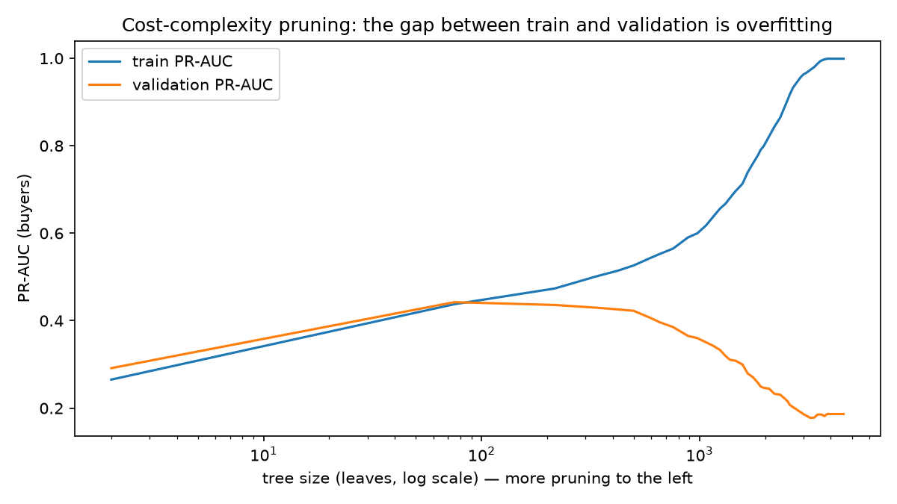
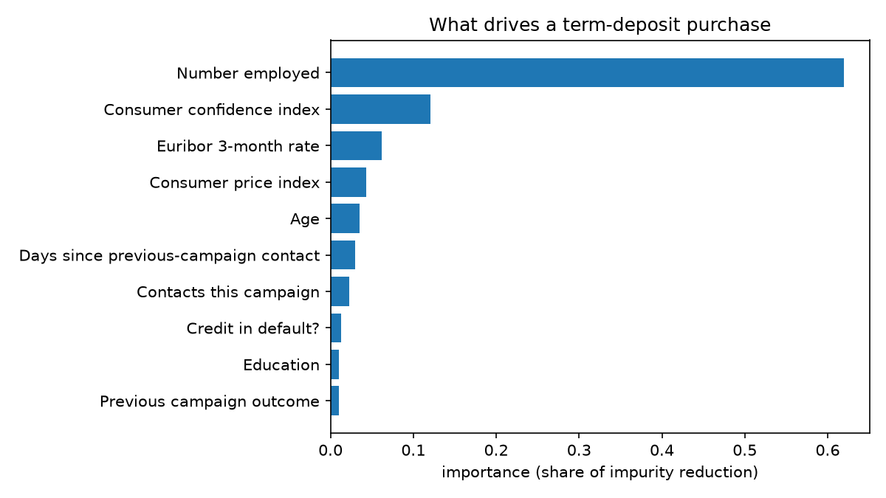

A Portuguese bank called 41,188 customers to sell them a term deposit. About 1 in 9 said yes.
If you could predict who those people were *before* dialing, the same sales team could make far
fewer calls for the same number of sales.

That's the problem behind this project: a capstone from my UT Austin Post-Graduate Program in AI &
Machine Learning, rebuilt from scratch on the openly licensed
[UCI Bank Marketing dataset](https://archive.ics.uci.edu/dataset/222/bank+marketing). You can
[try the live model](https://srikarbolleddu.com/projects/purchase-prediction-system#demo), and
the [code is on GitHub](https://github.com/srikarbolleddu/ml-purchase-prediction).

This post covers the three things that mattered most:

1. A model that's nearly perfect on training data can be close to useless.
2. Pruning a decision tree fixes that, and there are two ways to do it.
3. Some columns look predictive only because they come from the future.

## The 0.999 tree

A decision tree keeps splitting the data ("Is the customer over 60?", "Was the last contact in
May?") until every leaf is pure. If you don't stop it, it gets there: in my first run it grew
**4,581 leaves, 47 levels deep**.

On the training data it was almost flawless:

| | Training | Validation | Test |
|---|---|---|---|
| PR-AUC | **0.999** | 0.187 | 0.174 |
| Recall | 0.97 | 0.34 | 0.30 |

A PR-AUC of 0.999 means the tree ranked every buyer above almost every non-buyer, but only for
customers it had already seen. On new customers it dropped to 0.17. The tree hadn't learned what
makes someone buy; it had memorized 24,712 individual customers, including the noise.

That's **overfitting**, and decision trees are especially prone to it. A deep enough tree can
always isolate each training example in its own leaf.

> **Why PR-AUC and not accuracy?** With only 11% buyers, a model that says "no" to everyone is 89%
> accurate and completely useless. PR-AUC measures how well the model ranks the rare positive
> class, which is what a call list needs.

## Fix 1: pre-pruning (stop early)

The simplest fix is to stop the tree from growing so far. Two settings do most of the work:

- `max_depth`: how many questions in a row the tree may ask.
- `min_samples_leaf`: how many customers each final leaf must contain, so no single odd customer
  gets a rule of their own.

I searched a small grid and kept the tree with the best PR-AUC on the **validation** set, never the
training set:

```python
for depth in (3, 4, 5, 6, 8, 10):
    for leaf in (10, 25, 50, 100, 200):
        candidate = build_pipeline(max_depth=depth, min_samples_leaf=leaf).fit(x_train, y_train)
        score = scores(y_val, proba(candidate, x_val))["pr_auc"]
        if score > best_pre_score:
            best_pre, best_pre_score = candidate, score
```

The winner: **depth 10, 95 leaves**. Its training PR-AUC fell from 0.999 to 0.463, and its test
PR-AUC rose from 0.174 to **0.452**. Training and test scores now agree, which is what a model
that generalizes looks like.

## Fix 2: post-pruning (grow, then cut back)

The other approach is to grow the full tree and then remove the branches that don't earn their
keep. scikit-learn does this with **cost-complexity pruning**. Each subtree is scored as

> error + α × (number of leaves)

so a larger α makes every extra leaf more expensive. The full tree is α = 0; as α rises, branches
whose leaves don't reduce error enough get cut, until only a stump is left. scikit-learn gives you
every α where the tree changes:

```python
path = full_tree.cost_complexity_pruning_path(x_train_encoded, y_train)
for alpha in path.ccp_alphas:
    candidate = build_pipeline(ccp_alpha=alpha).fit(x_train, y_train)
    # ...score each on validation, keep the best
```



This chart is the whole story in one picture. As the tree grows (to the right), the training score
keeps climbing toward 1.0. The validation score peaks at about 75 leaves and then *falls*:
everything past that point is the tree memorizing. In the
[live demo's Explore section](https://srikarbolleddu.com/projects/purchase-prediction-system#explore)
you can drag a slider along this curve.

Post-pruning found a **75-leaf** tree with test PR-AUC **0.442**, almost tied with pre-pruning.
I shipped the pre-pruned tree because it scored slightly higher on validation, which is how it was
always going to be chosen. Picking by test score would have quietly turned the test set into
another validation set.

| Tree | Leaves | Train PR-AUC | Test PR-AUC |
|---|---|---|---|
| Default (grown until pure) | 4,581 | 0.999 | 0.174 |
| Pre-pruned | 95 | 0.463 | **0.452** |
| Post-pruned (cost-complexity) | 75 | 0.438 | 0.442 |

## The column I had to throw away

The dataset includes `duration`: how long the sales call lasted. It's a very strong predictor;
people who stay on the line for ten minutes tend to buy. The dataset's own documentation warns
that it should be dropped for a realistic model.

The reason: **you only know how long a call lasted after it has ended**, and by then you also know
whether they bought. A model that uses `duration` can't decide *whom to call*, because the input
it relies on doesn't exist yet. This is **target leakage**: information from after the outcome
sneaking into the features.

So `duration` is excluded in one shared feature module that both training and the live API use.
The API also rejects requests that include it, so it can't creep back in.

## Choosing who to call: the threshold

A tree outputs a probability. Turning that into "call" or "don't call" needs a cutoff, and 0.5
isn't special. I tuned it on validation data. Here's what the threshold does on the held-out test
customers:

| Threshold | Customers called | Buyers reached (recall) | Calls that convert (precision) |
|---|---|---|---|
| 0.30 | 5,099 | 87% | 16% |
| 0.50 | 1,569 | 62% | 37% |
| **0.65** (chosen) | 1,235 | 58% | **44%** |

At the chosen threshold, 44% of calls reach a buyer, about **3.9× better than calling at random**
(11%), while still reaching 58% of all buyers. If the bank cared more about reaching every buyer
than about wasted calls, it would pick a lower threshold. The point is to make that trade-off on
purpose. The demo's threshold slider shows the confusion matrix changing live.

## What actually drives purchases

The surprise was in the feature importances:



The top features aren't about the customer at all. **Number employed** (a quarterly national
employment indicator) accounts for 62% of the tree's importance, followed by consumer confidence
and the Euribor interest rate. In this data, *when* the bank called mattered more than *who* it
called: the campaign ran across 2008–2010, and economic conditions shifted purchase rates
dramatically.

Two caveats:

- Impurity-based importance favours features with many distinct values, so treat it as a ranking,
  not a measurement.
- A model built on macro indicators will need retraining as the economy changes. In production I'd
  monitor for that drift.

The strongest customer-level signal is history: customers whose **previous campaign was a success
bought 65% of the time**, against an 11% base rate.

## Every prediction explains itself

A big reason to use a decision tree here is that you can show your work. For every prediction the
API returns the exact path through the tree, with the share of training customers who bought at
each step:

1. Number employed ≤ 5,088 thousand (44% bought)
2. Customer was contacted in a previous campaign (68%)
3. Contact weekday: not Monday (72%)
4. Number employed ≤ 5,050 thousand (75%)
5. Euribor 3-month rate ≤ 0.72% (83%)

A sales manager can read that and decide whether they trust it. Few models offer that.

## From notebook to live demo

The original coursework was a Jupyter notebook. To make it something you can use:

- **Shared feature code.** Cleaning and feature definitions live in one module that training and
  the API both import, so they can't drift apart.
- **Reproducible training.** One script downloads the dataset, checks its SHA-256, uses fixed seeds
  and a 60/20/20 split, and writes the model plus every number on this page.
- **Safe model files.** The model is saved with `skops`, which loads only allow-listed types,
  instead of pickle, which can run arbitrary code.
- **Golden tests.** The shipped model must reproduce predictions recorded at training time.
- **Serving.** A FastAPI service on AWS Lambda behind a throttled API Gateway. The same React demo
  ([ml-demo-kit](https://github.com/srikarbolleddu/ml-demo-kit)) runs on GitHub Pages and on my
  portfolio.

## Takeaways

1. **A near-perfect training score is a warning sign.** Always compare against data the model
   hasn't seen.
2. **Prune decision trees.** Pre-pruning and cost-complexity post-pruning got to nearly the same
   place here; both beat the unpruned tree by 2.5×.
3. **Ask when each feature becomes known.** If it's only known after the outcome, it's leakage.
4. **Pick the threshold for the business**, not 0.5.
5. **Look at what the model relies on.** Sometimes the most important feature isn't about the
   customer at all.

[Try the model](https://srikarbolleddu.com/projects/purchase-prediction-system#demo) ·
[Read the code](https://github.com/srikarbolleddu/ml-purchase-prediction)

*Capstone project, UT Austin Post-Graduate Program in AI & Machine Learning, rebuilt on the UCI
Bank Marketing dataset (Moro, Rita & Cortez, 2014), CC BY 4.0.*
